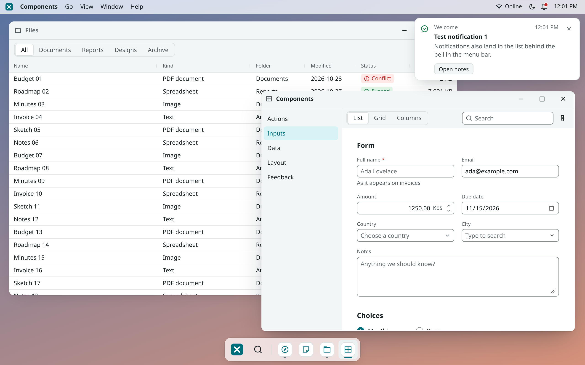
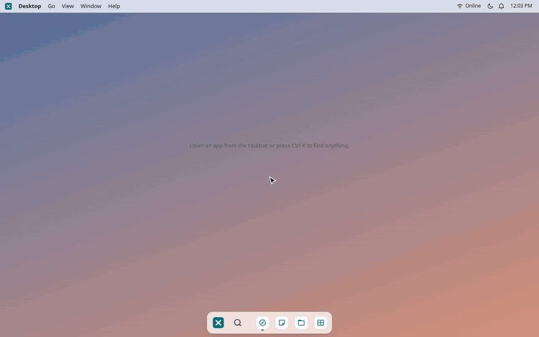
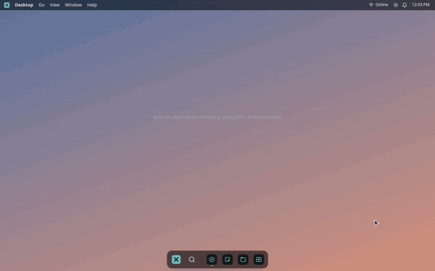
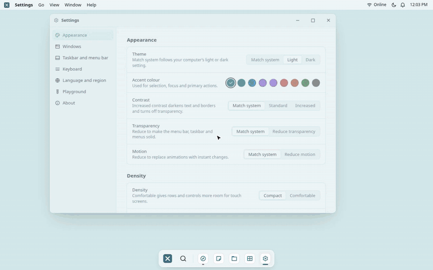
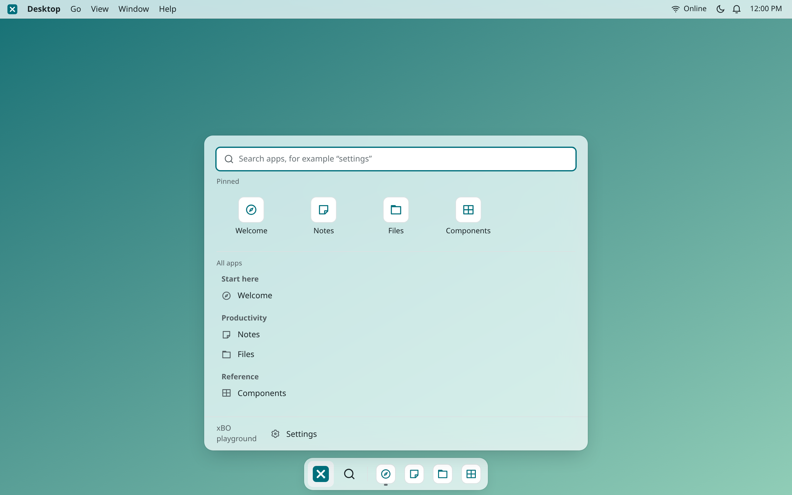
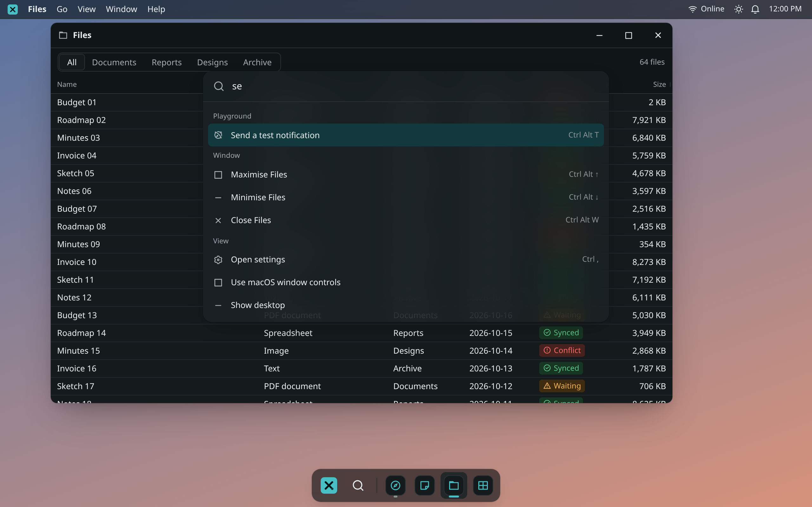
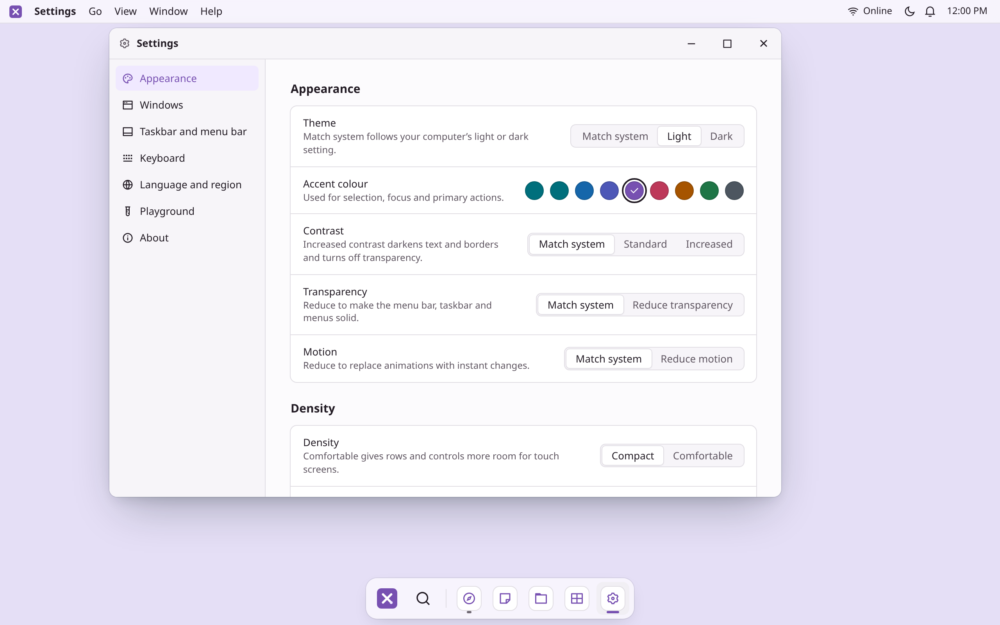
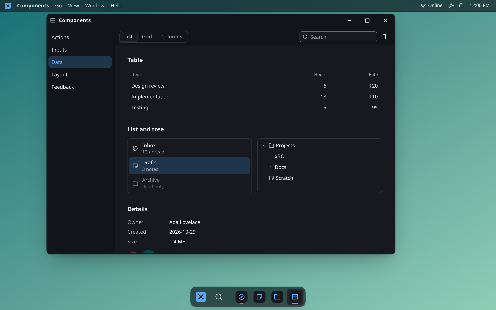

<div align="center">


# xBO

**Desktop-style applications for the web and Tauri, in Vue 3.**

Windows, menus, a taskbar, a command palette, settings, theming and a component kit, configured with one call.

[](https://github.com/cyenite/xBO/actions/workflows/ci.yml)
[](LICENSE)
[](https://vuejs.org)
[](https://tauri.app)
[](https://www.typescriptlang.org)
[](docs/ROADMAP.md)

[Quick start](#quick-start) · [Features](#features) · [Configuration](#configuration) · [Documentation](apps/docs) · [Roadmap](docs/ROADMAP.md) · [Contributing](CONTRIBUTING.md)

<br>

<picture>
  <source media="(prefers-color-scheme: dark)" srcset="docs/media/hero-dark.png">
  
</picture>

</div>

## Why xBO

Back-office tools, admin panels and internal apps usually end up as a page with a sidebar, where every record opens on top of the last and nothing can sit side by side. xBO gives those apps a real desktop instead: several windows open at once, snapped next to each other, driven from the keyboard, in a theme the user picked. It runs fullscreen in a browser tab, embedded in any page, or as a native app through Tauri, from the same code.

You register your app's windows with `createXbo()`. xBO supplies the rest.

<table>
  <tr>
    <td width="33%" valign="top">
      <h3>A real desktop</h3>
      Windows that drag, resize, snap to halves and quarters and remember where they were. A menu bar that follows the focused app, a taskbar, a Start launcher and a window switcher.
    </td>
    <td width="33%" valign="top">
      <h3>Keyboard first</h3>
      A command palette that searches apps, windows and commands. Every shortcut is listed, rebindable in Settings, and scoped to the app or the window that owns it.
    </td>
    <td width="33%" valign="top">
      <h3>Settings users expect</h3>
      Light and dark, accent colour, contrast, transparency, motion, density, text size, wallpaper, window controls, taskbar position and language, saved per user.
    </td>
  </tr>
  <tr>
    <td width="33%" valign="top">
      <h3>Accessible by default</h3>
      Full keyboard operation, WCAG 2.2 AA contrast checked automatically for any accent colour, and status never shown by colour alone. CI runs axe in light and dark.
    </td>
    <td width="33%" valign="top">
      <h3>Configurable, not forked</h3>
      Brand, apps, menus, status items, shortcuts, theme tokens, locked or hidden preferences, storage, startup, routing and language are all configuration.
    </td>
    <td width="33%" valign="top">
      <h3>A good guest</h3>
      One precompiled stylesheet that never restyles the host page. No global reset, prefixed utilities, and every token scoped to the desktop. Optional Tailwind CSS v4 tokens.
    </td>
  </tr>
</table>

## Features

### Windows that behave like windows

Drag a window to an edge to snap it, to the top to fill the screen, or use the keyboard. Every window keeps its own menus, title, unsaved-changes guard and window-modal sheets, so a question in one window never blocks the others.

<p align="center">
  
</p>

### One shortcut to everything

<kbd>Ctrl</kbd> <kbd>K</kbd> (<kbd>⌘</kbd> <kbd>K</kbd> on a Mac) opens the command palette. It ranks apps, open windows and every command an app registers, and shows each one's shortcut.

<p align="center">
  
</p>

### A theme that belongs to the user

Eight accent presets or any colour you choose, each contrast-checked in light and dark. Users change theme, accent and wallpaper in the built-in Settings app and the whole desktop follows instantly.

<p align="center">
  
</p>

### Gallery

<table>
  <tr>
    <td width="50%"></td>
    <td width="50%"></td>
  </tr>
  <tr>
    <td align="center"><sub><b>Start launcher</b>: pinned apps, groups and search</sub></td>
    <td align="center"><sub><b>Command palette</b>: apps, windows and commands</sub></td>
  </tr>
  <tr>
    <td width="50%"></td>
    <td width="50%"></td>
  </tr>
  <tr>
    <td align="center"><sub><b>Settings</b>: built in, extensible with your own pages</sub></td>
    <td align="center"><sub><b>Component kit</b>: follows the user's theme and density</sub></td>
  </tr>
</table>

## Quick start

Scaffold a new app (add `--tauri` for the desktop integration):

```bash
pnpm create xbo my-app
```

Or add xBO to an existing Vue 3 project:

```bash
pnpm add @xbo-ui/vue vue
```

```ts
// main.ts
import { createApp } from 'vue';
import { createXbo, defineApp } from '@xbo-ui/vue';
import App from './App.vue';
import NotesApp from './NotesApp.vue';

const xbo = createXbo({
  brand: { name: 'Acme Desk', version: '1.0.0' },
  apps: [defineApp({ id: 'notes', label: 'Notes', component: NotesApp, isPinned: true })],
  startup: { open: ['notes'] },
});

createApp(App).use(xbo).mount('#app');
```

```vue
<!-- App.vue -->
<script setup lang="ts">
import { XboDesktop } from '@xbo-ui/vue';
</script>

<template>
  <XboDesktop />
</template>
```

Inside a window, apps talk to the desktop through composables:

```ts
const current = useCurrentWindow();
current.setTitle('Quarterly plan');
current.setDirty(true); // closing now asks before discarding
useShortcut('notes:save', save, { label: 'Save note', binding: 'Mod+S', scope: 'window' });
useNotifications().notify({ title: 'Saved', tone: 'success' });
```

> [!NOTE]
> xBO is pre-release and the packages are not on npm yet. Until the first release, clone the repository and run the playground (see [Development](#development)).

## Packages

| Package | What it is |
| --- | --- |
| [`@xbo-ui/vue`](packages/vue) | The Vue 3 desktop: `createXbo`, `<XboDesktop>`, composables, the built-in Settings and About apps, and the component kit. Re-exports `@xbo-ui/core`. |
| [`@xbo-ui/core`](packages/core) | Framework-free logic: window management and geometry, shortcuts, search ranking, OKLCH theming with contrast checks, preferences and storage adapters. |
| [`@xbo-ui/tauri`](packages/tauri) | Tauri 2 integration: native window controls in the menu bar, app-data storage and external links. Adds nothing in a browser, so one configuration serves both. |
| [`create-xbo`](packages/create-xbo) | `pnpm create xbo` scaffolds a Vite + Vue 3 app with one window. |
| [`apps/playground`](apps/playground) | A kitchen-sink app that exercises every feature. Also the end-to-end test target and a Tauri desktop build. |
| [`apps/docs`](apps/docs) | The documentation site (VitePress), with live desktops embedded in the pages. |

## Configuration

Everything below is an option to `createXbo()`; nothing needs a fork.

<details>
<summary><b>All configuration options</b></summary>
<br>

| Area | Options |
| --- | --- |
| Brand | `name`, `mark` (component), `version`, `description`, `homepage`, `copyright` |
| Apps | `defineApp({ id, label, icon, component, group, summary, keywords, defaultSize, minSize, maxSize, isResizable, isSingleInstance, isPinned, isHidden, menus })`, `groups` |
| Shell | `shell: { isFullscreen, hasMenuBar, hasTaskbar, hasLauncher, hasPalette, hasNotifications, hasAppearanceToggle, desktopHint, compactWorkspaceWidth }` |
| Menus | `menus`, `helpMenu`, per-app `menus`, per-window `useCurrentWindow().setMenus()` |
| Menu bar | `statusItems` (components), `account` (component) |
| Theme | `theme: { preset, accent, light, dark, radius, fonts }`; eight presets, any accent colour (contrast-checked), token overrides |
| Wallpapers | `wallpapers`: the gradients, colours and images offered in Settings |
| Preferences | `preferences: { defaults, locked, hidden, storage, namespace }`; storage adapters for `localStorage`, memory, or your own (sync or async) |
| Shortcuts | `shortcuts` overrides; apps add rebindable shortcuts with `useShortcut()` |
| Settings | `settingsSections` to add your own pages to the built-in Settings app; `useAppPreference()` for app-specific values |
| Startup | `startup: { open, isSessionRestored }`, `routing: 'hash' \| 'none'` (deep links like `#/notes?id=42`) |
| Language | `i18n: { locale, messages, locales }`; every built-in string is a message key |

</details>

<details>
<summary><b>What users can change in Settings</b></summary>
<br>

Theme (light, dark, system), accent colour, contrast, transparency, motion, density, text size, corner radius, wallpaper, window controls (macOS or Windows style), remembered window sizes, session restore, taskbar position, alignment and auto-hide, menu bar clock, do not disturb, every keyboard shortcut, language and clock format. Any of these can be given a default, locked or hidden through `preferences`.

</details>

<details>
<summary><b>Default keyboard shortcuts</b> (all rebindable)</summary>
<br>

| Shortcut | Action |
| --- | --- |
| <kbd>Ctrl</kbd> <kbd>K</kbd> (<kbd>⌘</kbd> <kbd>K</kbd> on Mac) | Command palette |
| <kbd>Ctrl</kbd> <kbd>Esc</kbd> | Start launcher |
| <kbd>Ctrl</kbd> <kbd>,</kbd> (<kbd>⌘</kbd> <kbd>,</kbd> on Mac) | Settings |
| <kbd>Ctrl</kbd> <kbd>`</kbd> | Switch windows |
| <kbd>Ctrl</kbd> <kbd>Alt</kbd> <kbd>←</kbd> / <kbd>→</kbd> | Snap the focused window left or right |
| <kbd>Ctrl</kbd> <kbd>Alt</kbd> <kbd>↑</kbd> | Fill the screen |
| <kbd>Ctrl</kbd> <kbd>Alt</kbd> <kbd>↓</kbd> | Restore, then minimise |
| <kbd>Ctrl</kbd> <kbd>Alt</kbd> <kbd>W</kbd> | Close the focused window |
| <kbd>Ctrl</kbd> <kbd>Alt</kbd> <kbd>N</kbd> | New window of the focused app |
| <kbd>Ctrl</kbd> <kbd>Alt</kbd> <kbd>M</kbd> | Notifications |

</details>

## Styling

`@xbo-ui/vue` ships one precompiled stylesheet. It never restyles the host page: utilities are prefixed, there is no global reset, and every token is a `--xbo-*` custom property scoped to the desktop. Apps that use Tailwind CSS v4 can add the tokens as utilities:

```css
@import 'tailwindcss';
@import '@xbo-ui/vue/tailwind.css';
```

Then `bg-window`, `text-ink-muted`, `ring-hairline`, `text-body` and friends follow the user's theme.

## Development

Requirements: Node.js 22 or later and pnpm 10.

```bash
pnpm install
```

```bash
pnpm build:libs
```

```bash
pnpm dev
```

The playground runs on http://localhost:5190 against the library sources, so edits hot-reload. `pnpm --filter @xbo-ui/playground desktop` runs it as a Tauri app (needs Rust).

Checks (CI runs the same):

```bash
pnpm typecheck
```

```bash
pnpm lint
```

```bash
pnpm test
```

```bash
pnpm build
```

The screenshots and GIFs in this README come from the playground. With `pnpm dev` running, regenerate them with (needs ffmpeg):

```bash
pnpm --filter @xbo-ui/playground media
```

## Contributing

Bug reports, fixes, components and documentation are all welcome; start with [CONTRIBUTING.md](CONTRIBUTING.md). Design rules for every component live in [DESIGN.md](DESIGN.md), product principles in [PRODUCT.md](PRODUCT.md), and what is planned in the [roadmap](docs/ROADMAP.md). Please report security issues as described in [SECURITY.md](SECURITY.md).

## Licence

[MIT](LICENSE)
